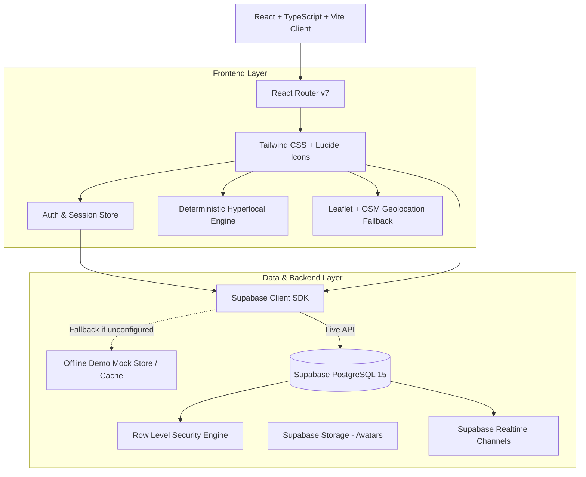
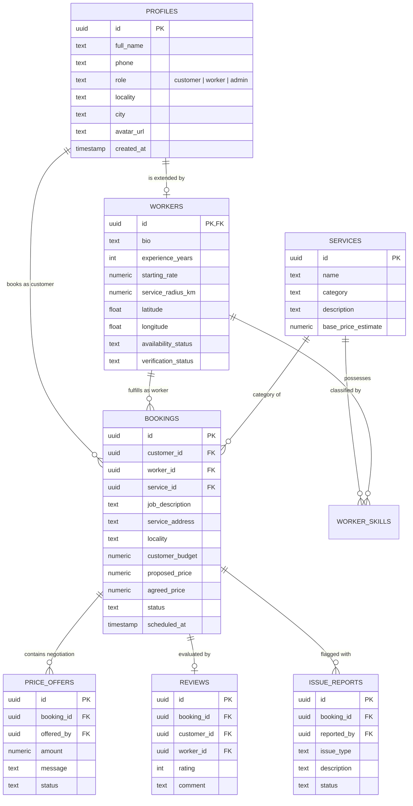

# KaamConnect — Hyperlocal On-Demand Blue-Collar Services Platform

> **"Local Skills. Trusted Services. Fair Opportunities."**  
> *A full-stack, responsive marketplace prototype connecting urban households with verified local blue-collar workers through transparent pricing, smart matching, and safety guarantees.*

---

## 🌟 Executive Summary

Finding reliable, affordable, and readily available blue-collar workers (electricians, plumbers, carpenters, house cleaners, painters, appliance technicians, cooks, maids, gardeners, movers) remains an everyday challenge for urban households. Simultaneously, skilled independent workers are penalized by traditional aggregators that charge exorbitant 20–30% commissions or enforce arbitrary pricing.

**KaamConnect** eliminates the middleman markup and restores dignity to local skilled trades by providing:
1. **Deterministic Smart Matching:** An explainable hyperlocal matching engine powered by the Haversine formula, availability status, user ratings, and customer budget.
2. **Transparent Price Negotiation:** Propose an initial price; workers can accept or provide justified counteroffers with itemized explanations.
3. **Completion Escrow Lock:** Workers cannot mark jobs completed unilaterally without customer confirmation and signature sign-off.
4. **Govt. ID Verification:** Administrator verification queue for Aadhaar/trade credentials with transparent unverified/pending badges.

---

## 🛠️ Technology Stack

| Layer | Technology | Details |
|---|---|---|
| **Frontend** | React 19 + TypeScript + Vite | Blazing fast modern reactive SPA |
| **Styling** | Tailwind CSS v4 | Curated dark navy `#0F172A` and emerald/teal `#0D9488` palette |
| **Icons** | Lucide React | Clean, modern iconography |
| **Database & Auth** | Supabase (PostgreSQL 15) | Relational schema, RLS policies, trigger constraints, migrations |
| **Maps & Geolocation**| Leaflet + OpenStreetMap | Interactive marker clusters, distance radius, and tile fallback |
| **Testing** | Vitest | 16 automated unit tests for Haversine distance, matching engine, and booking state machine |
| **Resilience Mode** | In-Memory / LocalStorage Mock Store | Out-of-the-box demo mode with 10+ workers, 10 services, reviews, and bookings |

---

## 🏗️ System Architecture



---

## 🗄️ Database Relational Schema (ERD)



---

## 🧠 Smart Hyperlocal Matching Engine

The deterministic matching engine calculates a normalized score from **0 to 100** with human explainability:

$$\text{MatchScore} = 0.35 \times S_{\text{distance}} + 0.25 \times S_{\text{availability}} + 0.20 \times S_{\text{rating}} + 0.20 \times S_{\text{affordability}}$$

1. **Eligibility Filtering:** Excludes workers outside their service radius or without the requested trade skill.
2. **Haversine Distance ($S_{\text{distance}}$):** Calculates great-circle distance between customer and worker coordinates. Closer workers score closer to 100.
3. **Availability ($S_{\text{availability}}$):** `Available` = 100, `Busy` = 40, `Offline` = 10.
4. **Rating ($S_{\text{rating}}$):** Proportional to average star rating ($(\text{rating}/5.0) \times 100$). New workers receive a neutral baseline score of 75 so they are not disadvantaged.
5. **Affordability ($S_{\text{affordability}}$):** Compares starting quote $R_w$ to customer budget $B_c$. If $R_w \le B_c$, score = 100; if higher, scores drop proportionally.

---

## 🚀 Quick Start & Installation

### 1. Clone & Install Dependencies
```bash
cd kaamconnect
npm install
```

### 2. Run Automated Unit Tests
```bash
npx vitest run
```
Runs 16 unit tests covering Haversine distance, edge cases, matching algorithms, booking state transitions, and price validation.

### 3. Run Development Server
```bash
npm run dev
```
Open **`http://localhost:5173`** in your browser.

---

## 🔑 Demo Personas for Quick Evaluation

The application includes an instant **Role Switcher** in the navbar and on the login page:

1. **Customer:** `Priya Verma` (`cust-priya`, Indiranagar, Bengaluru)
   - Can search services, review counteroffers (e.g., booking `book-102`), book new workers, and confirm job completion.
2. **Worker:** `Rajesh Sharma` (`w-rajesh`, Master Electrician, Bengaluru)
   - Can toggle live availability, review incoming booking requests, propose counteroffers, and manage active jobs.
3. **Administrator:** `KaamConnect Admin Desk` (`admin-super`)
   - Access to `/admin/dashboard` to approve/reject worker verification requests, mediate disputes, and track platform volume.

---

## 🗄️ Supabase Production Configuration

To link KaamConnect to a live Supabase PostgreSQL instance:

1. Create a project at [supabase.com](https://supabase.com).
2. Copy `.env.example` to `.env`:
   ```bash
   cp .env.example .env
   ```
3. Fill in your project keys:
   ```env
   VITE_SUPABASE_URL=https://your-project-id.supabase.co
   VITE_SUPABASE_ANON_KEY=eyJhbGciOi...
   ```
4. In the Supabase SQL Editor, run:
   - `supabase/migrations/20250101000000_init.sql` (Creates tables, triggers, indexes, and RLS policies)
   - `supabase/seed.sql` (Seeds catalog services)

*Note: If no `.env` is configured, KaamConnect automatically operates in resilient local demo mode with rich seed data.*

---

## 📄 License & Hackathon Notes
Built for the 24-Hour National Hackathon. Open-source prototype for non-profit and demonstration use.
